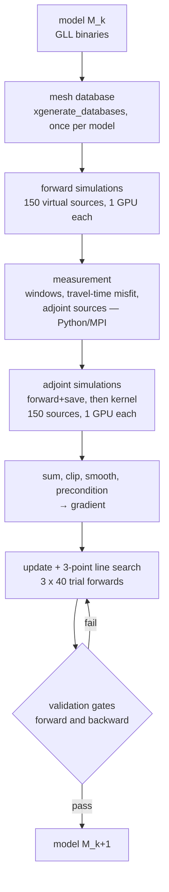

# specfem_WB1hz — GPU full-waveform inversion of Oregon's Willamette Valley, from one GPU to a rack

Code and workflow behind the Willamette Valley ambient-noise full-waveform inversion (FWI), built
around the [SPECFEM3D Cartesian](https://github.com/SPECFEM/specfem3d) spectral-element solver, and its path from a single GPU to the
NVIDIA Vera Rubin NVL72 racks of OSU's Huang Complex. The repository accompanies an application to
the OSU Huang Complex Supercomputing Seed Fund (2026 round).

This repository shows code and workflow; it is not a runnable package.

**Start here for multi-GPU use: [`multi_gpu/README.md`](multi_gpu/README.md).**

## Multiple GPUs in parallel

An iteration is ~420 independent simulations (150 forwards, 150 adjoints, 120 line-search forwards).
1. **Across sources (the bulk):** one simulation per GPU, dispatched by a per-node GPU pool, a Slurm
   job array (`%72` = one rack in flight) or a Kubernetes indexed job; tasks coordinate only through
   completion markers (`multi_gpu/`).
2. **Within one simulation:** SPECFEM's MPI domain decomposition, one GPU per rank, for the 1 Hz
   adjoint, Cascadia scenarios (6–8 GPUs) and 2 Hz (`multi_gpu/slurm/one_source_on_4_gpus.sbatch`).
3. **GPU-to-GPU halo exchange over NVLink:** planned development (SPECFEM 4.1.1 stages halos through host memory).

Status: production has run on one RTX 5090 and the solver stages on one GH200; domain decomposition has run
on CPUs (Anvil, 1,250 ranks). The multi-GPU dispatch is tested in dry-run mode, which needs no GPU
or SPECFEM (example output: [`multi_gpu/event_parallel/dry_run_example.txt`](multi_gpu/event_parallel/dry_run_example.txt)):

    mkdir -p /tmp/wb_ev/XX.S{01..12}_Z
    multi_gpu/event_parallel/run_sources_on_gpus.sh --gpus 4 --events /tmp/wb_ev --out /tmp/wb_out --dry-run

## What has run where

| platform | what ran | key numbers |
|---|---|---|
| **1 x RTX 5090** (x86, Blackwell, 32 GB) | the full autonomous inversion loop, one source at a time: 15 validated model updates (9 on a coarse 0.2 M-element mesh, then 6 on the 0.54 M-element 2 s mesh with 150 virtual sources), 932 stations | 18.2 GPU-hours per iteration; 2 s resolution is the most one card can do |
| **1 x GH200 Grace Hopper** (Arm, Hopper) | the same workflow, built on aarch64 with no source changes; forward runs validated against x86; adjoint timed with synthetic adjoint sources; measurement stages built and MPI-tested only (no observed data on the node); runs launched directly, without a scheduler | seismograms within 7.2 ppm of x86 (x86's own rerun scatter: 8.3 ppm); 1.7x the RTX 5090; ~11 GH200-hours per iteration (projected from measured per-source legs); 1 Hz forward in 43 GB |
| **Purdue Anvil** (ACCESS, AMD CPUs) | earlier runs of the same inversion workflow with 1,250 MPI ranks per simulation; a Slurm job-array port of the current loop for the 1.5 s / 1 s meshes (dry-run tested with a mock scheduler) | 1.5 s: ~19,000 core-hours per iteration; 1 s: ~104,000 (planner) |
| **Vera Rubin NVL72** (planned) | 1.5 s and 1 Hz inversions and Cascadia M9 scenario ensembles; one source per GPU, multi-GPU simulations where one GPU is too small | see `multi_gpu/README.md` |

Measured Grace Hopper results: [`docs/GH200_RESULTS.md`](docs/GH200_RESULTS.md).

## The inversion loop

Every stage is a set of independent, resumable tasks coordinated only by completion markers on the
filesystem (`.event_done`, `.kernel_done`, `.stage_done`). In production the loop has run as a plain
shell loop on one GPU; the same tasks are packaged as Slurm job arrays (Anvil port, tested with a
mock scheduler) and as a Kubernetes indexed job (example manifest, not yet run), so no
scheduler-specific logic is needed.

## Repository map

| path | contents |
|---|---|
| `workflows/rtx5090/` | the production single-GPU workflow: build, mesh, model, benchmark, the autonomous loop (`run_loop.sh`), forward/adjoint/post-processing/update stages, the Python measurement pipeline (`cal_adjoint/`), tools |
| `workflows/grace_hopper/` | the Arm/Hopper machine file plus validation and timing harnesses (the workflow itself is `rtx5090/`) |
| `workflows/anvil_slurm/` | the Slurm job-array port for Purdue Anvil: one array task per source, 512–2,048 MPI ranks per source, mesh planner |
| `multi_gpu/` | how sources are dispatched across many GPUs (shell pool, Slurm array, Kubernetes indexed job) and how one simulation is split across GPUs |
| `patches/` | build settings and fixes to SPECFEM3D 4.1.1 (new GPU targets, ASDF adjoint input, database-generation speed-up, described; patch to be added) |
| `docs/` | GPU notes, Grace Hopper results, ASDF notes, hard-won gotchas |
| `benchmarks/` | seismogram validation reports (reruns, output formats, control) |

## Not included

- **SPECFEM3D Cartesian 4.1.1** source and binaries: the upstream release
  [v4.1.1](https://github.com/SPECFEM/specfem3d/tree/v4.1.1) (commit `c67d3ae`, GPL-3.0), e.g.
  `git clone --branch v4.1.1 --depth 1 https://github.com/SPECFEM/specfem3d.git`. All production runs
  used it unmodified; build settings and optional fixes are in `patches/`.
- **Data**: observed noise correlations, station lists, velocity models (GLL binaries and
  tomography files), seismograms and kernels.
- **Vendored Python packages** used by `cal_adjoint/`: pyflex (https://github.com/krischer/pyflex)
  and pyadjoint (https://github.com/krischer/pyadjoint); other dependencies are listed in
  `cal_adjoint/pyproject.toml` / `uv.lock` (ObsPy, NumPy, pandas, mpi4py; Python 3.10).

## License

GNU General Public License v3.0; see [`LICENSE`](LICENSE). The patches in `patches/` and the
`Par_file` / `Mesh_Par_file` templates derive from SPECFEM3D Cartesian, which is also GPL-3.0.

## Affiliation

College of Earth, Ocean, and Atmospheric Sciences, Oregon State University.
