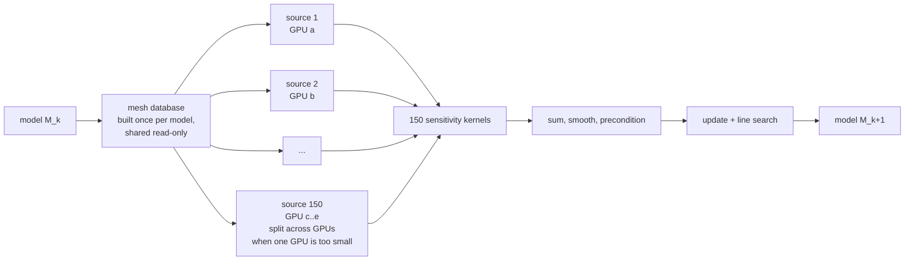

# How the workflow will use many GPUs in parallel

A full-waveform inversion iteration is hundreds of independent wave simulations: one forward and one
adjoint simulation for each of 150 virtual sources, plus 3 x 40 line-search forwards. The workflow
is designed to use GPUs in parallel at three levels; the status of each is under *Measured vs planned* below.

## Level 1 — across sources: one simulation per GPU (the bulk of the work)

Each virtual source is an independent simulation, so the 150 sources of an iteration (and the 40
sources of each line-search trial) run on as many GPUs as are available, one source per GPU, in any
order. Coordination is only through completion markers on the shared filesystem, so a shell pool,
a Slurm array, or a Kubernetes/Run:ai indexed job can dispatch, retry and backfill sources without
any scheduler-specific logic.

| file | dispatches sources by |
|---|---|
| `worker_one_source.sh` | the unit of work: one source on one GPU (used by everything below) |
| `lib_multi_gpu.sh` | shared helpers: build the model's mesh database once, give each source a private work directory that symlinks it read-only |
| `event_parallel/run_sources_on_gpus.sh` | one worker loop per GPU on a node (e.g. the 4 GPUs of an NVL72 compute tray); atomic claims, restartable; `--dry-run` tests the dispatch without GPUs |
| `slurm/build_database.sbatch` + `slurm/forward_array_one_gpu_per_source.sbatch` | a Slurm job array, `--gres=gpu:1` per task, `%72` = one rack in flight |
| `kubernetes/indexed_job_one_gpu_per_source.yaml` | an Indexed Job with `nvidia.com/gpu: 1` per pod (the shape Run:ai / Mission Control schedule); illustrative |
| `../workflows/anvil_slurm/` | the same one-task-per-source pattern on Purdue Anvil CPUs (NPROC ranks per task) |

The files above dispatch the forward stage. The adjoint stage (forward+save, then kernel, in the same
work directory: `workflows/rtx5090/adjoint/run_adjoint.sh`) and the line-search forwards use the same
one-source-per-task pattern but are not yet wired into `multi_gpu/`.

Why one simulation per GPU: on a GH200, packing 2/4/8 forward simulations onto one GPU raised
throughput only 1.09/1.16/1.20x, because the solver's time loop already saturates the GPU. Campaign
throughput therefore scales with the number of GPUs, which is what a 72-GPU rack provides.

## Level 2 — within one simulation: domain decomposition across GPUs

When one simulation does not fit one GPU, SPECFEM3D partitions the mesh into
`NPROC = NPROC_XI x NPROC_ETA` slices, one MPI rank per slice and one GPU per rank; neighbouring
slices exchange boundary values every time step. SPECFEM binds rank r to device
`r % visible_devices`, so this needs no code change (`slurm/one_source_on_4_gpus.sbatch`).

| stage | memory per simulation | GPUs per simulation on Vera Rubin (288 GB each), planned; "~" = projected |
|---|---|---|
| 2 s (production today) | 6 GB forward, 13 GB kernel | 1 |
| 1.5 s | ~32 GB adjoint | 1 |
| 1 Hz forward | 43 GB (measured on GH200) | 1 |
| 1 Hz adjoint | ~100 GB state + ~0.6 TB reconstruction wavefield | 1 (wavefield in the superchip's host memory) or 3 (wavefield in HBM, simulation split) |
| Cascadia scenario (margin-scale, 1 Hz, attenuation) | ~1.1 TB | 6–8 (per-GPU cap ~5.7 M elements with attenuation) |
| 2 Hz (needs new dense data) | ~350 GB forward | >= 4 |

The project has run domain-decomposed simulations at 1,250 MPI ranks per simulation on Purdue Anvil
CPUs, and `../workflows/anvil_slurm/` plans 512 (1.5 s) and 2,048 (1 s) ranks per simulation in a
job array. On GPUs, multi-rank runs have not yet been executed: the GPU nodes available so far have
one GPU each. On an NVL72, a compute tray is one node with 4 GPUs; simulations on more GPUs
(scenarios, 2 Hz) span trays, which needs multi-node NVLink (IMEX) placement from the scheduler.

## Level 3 — GPU-to-GPU exchange over NVLink (planned development)

SPECFEM3D 4.1.1 packs the halo buffers on the GPU but copies them to host memory for MPI
(`src/gpu/assemble_MPI_vector_cuda.cu`, `gpuMemcpy_tohost_realw`). On a Vera Rubin superchip that hop is
the 1.8 TB/s NVLink-C2C link; the planned device-resident path (CUDA-aware MPI or NCCL) keeps the
exchange on the NVLink switch fabric. The change is bounded because the buffers are already packed
on the device. Acceptance test: a re-partitioned run reproduces the single-GPU reference
seismograms (the same validator used for the Grace Hopper port,
`../workflows/grace_hopper/validate_forward.py`), and >= 70 % parallel efficiency to 8 GPUs on a
>= 30 M-element mesh.

## Measured vs planned

| | status |
|---|---|
| one source at a time on one GPU, full inversion loop | **measured**: 15 validated model updates on one RTX 5090 (18.2 GPU-hours per iteration) |
| same workflow on an Arm superchip | **measured**: GH200, no source changes, seismograms within 7.2 ppm of x86, 1.7x the RTX 5090, a projected 11 GH200-hours per iteration from measured per-source legs (`../docs/GH200_RESULTS.md`) |
| many sources on many GPUs at once | dispatch code here; pool tested in `--dry-run`; one-GPU-per-task scheduling not yet run on a multi-GPU node |
| one simulation on many ranks | **run on CPUs** (Anvil, 1,250 ranks); on GPUs planned (standard SPECFEM path) |
| device-resident halo exchange | planned development |
